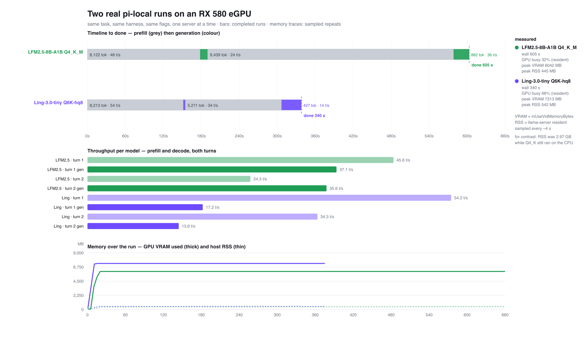
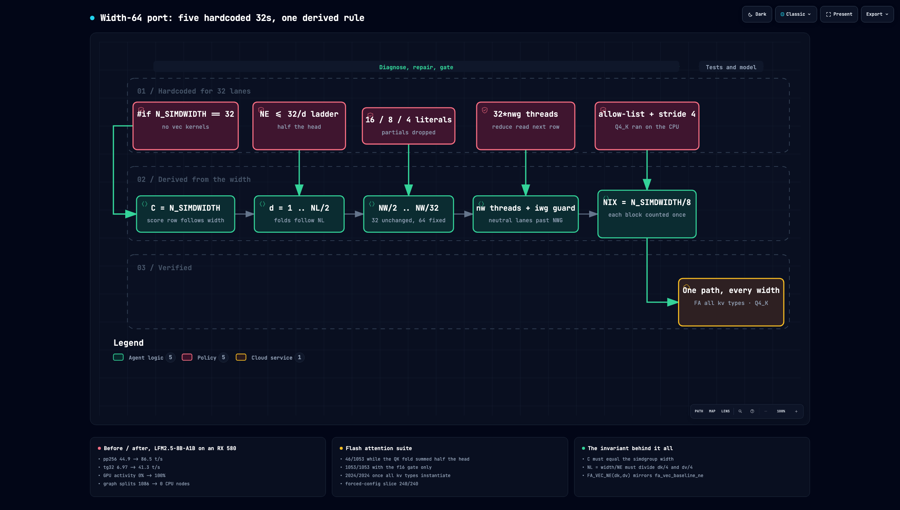

# llama.cpp on an Intel Mac with an RX 580 eGPU

A MacBook Pro with an AMD card in a Thunderbolt enclosure, driven at width 64 by
a backend that assumed 32. Twelve findings, every number measured on that
machine; the first ten ship as a patch, findings 11-12 are documented
change-by-change in [What is not done](#what-is-not-done). Nothing was
hardware-hacked and nothing was submitted upstream.



Two models, the same agent task, the same eGPU - timeline to done, per-turn
throughput, and what each one costs in VRAM. LFM2.5-8B-A1B finishes in 605 s
against Ling-3.0-tiny's 340 s, but it decodes 2-3x faster while Ling prefills
faster; memory separates them cleanly at 6.0 GB versus 7.3 GB. Full detail and
caveats in [Two models on the same agent task](#two-models-on-the-same-agent-task).

## Does this affect you?

You need the first two. Without the third, findings 1-7 and 11 still apply and
8-10 do not; finding 12 applies to any **Q4_K** model regardless of architecture.

1. A **non-Apple GPU** (AMD or Intel), where `has_simdgroup_reduction` is false
2. llama.cpp at **`a7af149`**
3. A **MoE or hybrid model** - anything with routed experts or gated delta net

Symptoms, and where to look first:

| what you see | start at |
|---|---|
| the card sits idle while the CPU is pinned | [8](#8-no-moe-model-runs-on-the-gpu-on-a-non-apple-device), [9](#9-gated_delta_net-cannot-run-on-the-gpu-at-all), [12](#12-the-wide-mat-vec-allow-list-excluded-q4_k-and-its-block-stride-was-4) |
| 1-3 t/s where the card should do 20+ | [8](#8-no-moe-model-runs-on-the-gpu-on-a-non-apple-device), [9](#9-gated_delta_net-cannot-run-on-the-gpu-at-all), [12](#12-the-wide-mat-vec-allow-list-excluded-q4_k-and-its-block-stride-was-4) |
| prefill collapses, decode is fine | [11](#11-flash-attention-at-width-64-the-row-width-two-fold-ladders-and-the-reduce) |
| `-fa on` makes it slower than `-fa off` | [11](#11-flash-attention-at-width-64-the-row-width-two-fold-ladders-and-the-reduce) |
| model "loads", VRAM nearly empty, RAM full | [8](#8-no-moe-model-runs-on-the-gpu-on-a-non-apple-device) |
| right speed, wrong text | [3](#3-use_concurrency-races-on-non-apple-gpus), [10](#10-the-q8_0-matvec-assumed-32-lanes-in-three-places) |
| a quantised file slower than f16 | [7](#7-quantisation-is-slower-than-f16-on-this-card) - expected, not a bug |

## What it buys

Ling-3.0-tiny Q6_K (7.9B MoE), same binary, same machine:

| | stock `a7af149` | patched |
|---|---|---|
| generation | 0.97 t/s | **19.7 t/s** |
| prompt processing | 15.5 t/s | **48.4 t/s** |
| weights in VRAM | 569 MiB | **6003 MiB** |
| weights in host RAM | 5,622 MiB | **188 MiB** |

Dense model, for scale: LFM3-1.7B does 11.8 t/s on 4 CPU threads and 36.8 t/s at
f16 on the card.

## Real workload, not a benchmark

`pi-local` running one agent task - "list the files here, which is the largest" -
against this server. It is a good task because the correct answer (`models`,
27 GB) needs a `du` scan, while a plain `ls` offers a tempting wrong answer
(`CFSG.tar.gz`, 5.7 GB).

Same server, same task, only the sampling default differs:

| temperature | run 1 | run 2 | answers |
|---|---|---|---|
| 1.0 (llama.cpp default) | 294 s | 61 s | correct, then **wrong** |
| 0.2 (`--temp 0.2`) | 187 s | **59 s** | correct, correct |

This is the most useful table here. Under the stock default the repeat run is
4.8x faster **and wrong**: the model skips the expensive tool call and answers
from the listing it already has. Sampled at 1.0 with a random seed, whether it
bothers to scan is luck, so "repeat run is faster" was measuring a worse answer.
No kernel or caching change fixes that.

**Pin it: start the server with `--temp 0.2`.** The launchers in `agents/` do.

What the numbers look like once the work is actually done, read from
`/metrics` at temperature 1.0:

| | first run | repeat run |
|---|---|---|
| prompt tokens processed | 8,936 | 1,846 |
| prompt tokens served from cache | 16,749 | 15,445 |
| tokens generated | 893 | 84 |
| prefill | 55 t/s | 40 t/s |
| generation | 10.6 t/s | 10.7 t/s |

Two facts survive the correction:

- **The prompt cache still pays.** 15-16k prompt tokens are served from cache per
  run, which is most of an agent's system prompt. Restarting `llama-server`
  throws that away, so a restart costs more than it looks.
- **Generation lands near 10.7 t/s, not the 19.7 t/s benchmark.** Agent turns are
  a few hundred tokens each, so per-turn fixed cost dominates. A cold first turn
  is prefill-bound: 162 s of that 294 s was prompt processing.

### Two models on the same agent task

The figure at the top of this page, in detail. Same task, same harness, same
flags, one server at a time. The bars come from
completed runs (two turns each); the memory traces are sampled repeats of the
same task, because a sampled run and a clean run are not the same run. The raw
samples and the generator sit next to the figure: `assets/pi-run-*.csv`,
`assets/sampler.py`, `assets/compare_chart.py`.

What it says, and what it does not:

- LFM2.5-8B-A1B finishes in **605 s** against Ling's **340 s**, and the difference
  is not decode: LFM2.5 runs 35-37 t/s decode against Ling's 14-17, while Ling
  prefills at 54 t/s against LFM2.5's 24-46. LFM2.5 is a reasoning-only model, so
  every turn also pays its chain of thought; this server runs Ling with
  `enable_thinking: false`.
- Memory separates them cleanly: **6.0 GB** of VRAM for LFM2.5 versus **7.3 GB** for
  Ling at 128k context, and host RSS stays under 550 MB for both - the weights are
  really in VRAM now ([finding 12](#12-the-wide-mat-vec-allow-list-excluded-q4_k-and-its-block-stride-was-4)).
  Before that fix the same LFM2.5 server held 2.97 GB of host RAM with the card idle.
- Single runs on one machine, and the Ling sample landed in a slower patch:
  25.6 t/s prefill at 8.2k there, against 54.2 t/s for the archived run of the same
  task. Treat the ordering as directional, not as a benchmark.

## Best config for a real agent

Measured with `pi-local` on this machine. Only one setting changed the *quality*
of the work; the rest are noise, and saying so is more useful than a list of
tunables.

```bash
GGML_METAL_DEVICE_NAME="Radeon RX 580" llama-server \
  -m Ling-3.0-tiny-Q6_K.gguf -ngl 999 -lm none -t 1 \
  -c 32768 -ub 256 -b 512 --temp 0.2 \
  --sleep-idle-seconds 1800 --metrics
```

| setting | use | measured reason |
|---|---|---|
| `--temp` | **0.2** | the only setting that changed correctness: at the 1.0 default, 294 s correct then 61 s wrong; at 0.2, 187 s and 59 s, both correct |
| `-ub` | 256 | 128 / 256 / 512 prefill a 4,470-token prompt at 69.6 / 69.5 / 68.7 t/s. No difference, so take the one with VRAM headroom |
| `--parallel` | leave at the default 4 | 1 slot and 4 slots prefill at 69.5 / 69.6 t/s; more slots keep more idle conversations cached, and the KV for this hybrid model is only 216 MiB |
| `-c` | 32768 | `n_ctx` is per slot. 65536 needs 5290 MB of buffers on top of 6003 MB of weights |
| `--sleep-idle-seconds` | 1800 while working, 300 to save RAM | sleeping frees 5.6 GB but drops the prompt cache, and re-prefilling a 15k agent prompt costs about 3.6 min |
| `-ngl 999 -lm none -t 1` | required | findings 1, 5 and 7 |

The number to plan with: **prefill runs at about 69 t/s**, and an agent turn
prefills its entire system prompt. At 15k tokens that is 3.6 minutes before the
first token, so keeping the cache alive beats every other knob here.

**Status: research notes, not an upstream-ready change.** The patch carries
temporary instrumentation and disables flash attention on this device. Read
[What is not done](#what-is-not-done) before using any of it.

## Contents

|  | finding | one line |
|---|---|---|
| 1 | [shared host buffers](#1-an-egpu-is-forced-onto-shared-host-buffers) | the card read every weight over Thunderbolt |
| 2 | [simdgroup width is hardcoded](#2-simdgroup-width-is-hardcoded-to-32-amd-is-64) | 32 lanes assumed, AMD has 64 |
| 3 | [concurrency races](#3-use_concurrency-races-on-non-apple-gpus) | 8 command buffers, no ordering |
| 4 | [SSM_CONV refused](#4-ssm_conv-is-refused-for-no-reason) | scalar kernel behind a vector gate |
| 5 | [mmap defeats private buffers](#5-mmap-keeps-weights-out-of-vram-even-when-buffers-are-private) | `newBufferWithBytesNoCopy` keeps weights on the host |
| 6 | [q5_K threadgroup shape](#6-the-q5_k-threadgroup-shape-is-tuned-for-another-gpu) | one constant, +10% |
| 7 | [quantisation is slower than f16](#7-quantisation-is-slower-than-f16-on-this-card) | integer work costs more than the bytes saved |
| 8 | [MoE never reaches the GPU](#8-no-moe-model-runs-on-the-gpu-on-a-non-apple-device) | `MUL_MAT_ID` refused outright |
| 9 | [GATED_DELTA_NET on the CPU](#9-gated_delta_net-cannot-run-on-the-gpu-at-all) | the gate, not the kernel, was the blocker |
| 10 | [Q8_0 assumed 32 lanes](#10-the-q8_0-matvec-assumed-32-lanes-in-three-places) | two lane bugs plus a missing allow-list entry |
| 11 | [flash attention at width 64](#11-flash-attention-at-width-64-the-row-width-two-fold-ladders-and-the-reduce) | row width, two fold ladders, one reduce |
| 12 | [the wide allow-list and Q4_K](#12-the-wide-mat-vec-allow-list-excluded-q4_k-and-its-block-stride-was-4) | a missing type plus a stride of 4 |

Patch: [`patches/rx580-metal-width64.patch`](patches/rx580-metal-width64.patch)
carries findings 1-10. [`patches/upstream-metal-fixes.patch`](patches/upstream-metal-fixes.patch)
carries only findings 3 and 4, for anyone who wants the two safe ones alone.
**Apply one or the other, not both.** Findings 11-12 are not in either patch yet -
see the first two items of [What is not done](#what-is-not-done).

## How to apply

The patches are generated against one revision. Another revision will reject
them, and a rejected hunk is not a warning to ignore.

```bash
git clone https://github.com/ggml-org/llama.cpp
cd llama.cpp
git checkout a7af149          # the revision every number here was measured on
git log --oneline -1          # expect: a7af149a2 cuda : add top-k MoE fusion for 384 experts

# full patch: findings 1-10
curl -L -o rx580.patch \
  https://raw.githubusercontent.com/thiensubs/llama-cpp-rx580-egpu/main/patches/rx580-metal-width64.patch

# or, only findings 3 and 4:
#   .../patches/upstream-metal-fixes.patch

git apply --check rx580.patch   # must print nothing
git apply rx580.patch

cmake -B build -DGGML_METAL=ON -DCMAKE_BUILD_TYPE=Release
cmake --build build -j4 --target llama-server llama-cli test-backend-ops
```

If `git apply --check` prints anything, stop: the checkout is not `a7af149` and
the result will be the slow state rather than a partial fix.

Then run the gates in [Reproduce](#reproduce). The three that matter for the
patch are `MUL_MAT_ID` 224/224, `type_a=q8_0` 116/116, and a `-lv 4` load that
shows the weights in `MTL0_Private` instead of on the CPU. Findings 11-12 add two
more, and they are the ones a wrong lane mapping cannot fake:
`FLASH_ATTN_EXT` 2024/2024 and `MUL_MAT, MUL_MAT_ID` 1384/1384 across all types.

## Headline numbers

LFM3-1.7B, one binary, one machine:

| config | generation | CPU per token | cores busy |
|---|---|---|---|
| CPU, 4 threads, Q5_K | 11.8 t/s | 0.346 s | 374% |
| GPU, whole graph, Q5_K | 28.2 t/s | 0.008 s | 20% |
| GPU, whole graph, f16 | **36.8 t/s** | 0.008 s | 20% |

Prompt processing 49 t/s on Q5_K, 77 t/s on f16. Energy 0.27 Wh per 1000 tokens.

Two results matter more than raw speed:

- **The smaller model is slower.** f16 beats Q5_K beats Q4_0/Q8_0 on this card
  ([finding 7](#7-quantisation-is-slower-than-f16-on-this-card)). Compression
  trades bandwidth for integer work, and this GPU is on the wrong side of that
  trade.
- **A 7.9B MoE went from no request finishing to 20.8 t/s** once three support
  gates were corrected ([findings 8-10](#8-no-moe-model-runs-on-the-gpu-on-a-non-apple-device)).
  Its weights had been sitting in host RAM the whole time.

## The machine

| part | detail |
|---|---|
| host | MacBook Pro (MacBookPro13,3), Intel Core i7-6700HQ, 17 GB RAM |
| OS | macOS 15.7.7, build 24G720, installed with OpenCore Legacy Patcher (unsupported hardware) |
| toolchain | Apple clang 17.0.0 (clang-1700.6.4.2), cmake 4.4.4 |
| GPU 0 | AMD Radeon RX 580, 8 GB, Thunderbolt enclosure (`MTLDeviceLocationExternal`) |
| GPU 1 | AMD Radeon Pro 450, 2 GB, internal |
| GPU 2 | Intel HD 530, integrated |
| llama.cpp | `a7af149` exactly; see [How to apply](#how-to-apply) |
| models | LFM3-1.7B f16 and Q5_K_M; Ling-3.0-tiny Q6_K (7.9B MoE) |

Measured streaming bandwidth: RX 580 **217 GB/s**, internal Pro 450 **74 GB/s**
(`repro/bwprobe.m`).

## Quick start

Text model, whole graph on the card:

```bash
GGML_METAL_DEVICE_NAME="Radeon RX 580" llama-server \
  -m model.gguf -ngl 999 -lm none -t 1 -c 65536 -ub 256 --temp 0.2 --metrics
```

Four flags carry all of the performance:

| flag | why |
|---|---|
| `-ngl 999` | whole graph on the card; otherwise the CPU threads compete with a GPU that is idle |
| `-lm none` | **required**; mmap pins weights to host memory ([finding 5](#5-mmap-keeps-weights-out-of-vram-even-when-buffers-are-private)) |
| `-t 1` | with the graph on the GPU the CPU threads only spin (0.008 vs 0.067 CPU-s per token) |
| `-ub 256` | 512 is faster per token but costs prompt rework; below 256 the prompt cache stops working |

Keep weights at f16. Q5_K is the low-VRAM fallback, not a speed win.

### Context sizing

| context | KV | buffers | generation |
|---|---|---|---|
| 32k | fp16 | 2854 MB | 24.45 t/s |
| 64k | fp16 | 4430 MB | 24.46 t/s |
| 64k | q8_0 | 1678 MB | 16.49 t/s |
| 128k | fp16, `-ub 512` | - | **fails to allocate** (7156 MB) |
| 128k | fp16, `-ub 256` | 5290 MB | 26.7 t/s |
| 128k | q8_0, `-ub 512` | 2106 MB | 17.28 t/s |

The second buffer is not the KV cache, it is the compute graph, and it scales
with **ubatch** as well as context. At `-c 65536`: `-ub 512` -> 2375 MB,
`-ub 256` -> 1221 MB, `-ub 128` -> 644 MB, with KV constant at 805 MB. That is
why 128k looked impossible at full precision until ubatch was cut: KV at 128k is
only 1.61 GB, while the compute buffer at `-ub 512` was 4.3 GB.

Ubatch also sets latency: `llama-server` re-evaluates `ubatch + 4` prompt tokens
per request, so a 4k prompt costs 516 tokens of rework at `-ub 512` (16.9 s) and
260 at `-ub 256` (8.2 s). Below 256 the cache stops working outright (4001
tokens reprocessed per request).

#### Long context on one card

The buffer that grows with context is **not the KV cache, it is the compute
buffer**. Ling-3.0-tiny on the RX 580, measured at load:

| context | KV | compute | total | fits in 8192? |
|---|---|---|---|---|
| 32k | 216 MiB | 604 MiB | 6900 MiB | yes, 1292 free |
| 131k, `-ub 256`, fp16 KV | 864 MiB | **2331 MiB** | 9275 MiB | no, 1083 over |
| 131k, `-ub 128`, q8_0 KV | 459 MiB | **17 MiB** | 6479 MiB | yes, 1713 free |

So 131k needs a smaller ubatch and a quantised KV, not more VRAM:
`-c 131072 -ub 128 -ctk q8_0 -ctv q8_0` serves at **22.5 t/s** against 27.9 t/s
at 32k. Adding a second GPU for the KV cache does not help: the KV is the smaller
term, and llama.cpp binds it to the model's device anyway (`--no-kv-offload`
moves it to host RAM, not to another card).

### Vision

LFM3-VL-2B plus projector: add `--image-max-tokens 256`. Without it the encoder
sizes its compute buffer from the image, and a 1680x2866 chart asked for 16.9 GB
and died.

## Findings

### 1. An eGPU is forced onto shared (host) buffers

**Cause.** `ggml-metal-device.m` treats "external" as "prefer shared":

```objc
dev->props.use_shared_buffers = dev->props.has_unified_memory;
#if TARGET_OS_OSX && TARGET_CPU_X86_64
    // In case of eGPU, shared memory may be preferable.
    dev->props.use_shared_buffers |= [dev->mtl_device location] == MTLDeviceLocationExternal;
#endif
```

Shared means zero-copy host memory: the weights never enter VRAM and the card
reads them across PCIe on every token.

**Measured.** Same kernel, both ways (`test-backend-ops perf`, q5_K, m=4096,
k=14336):

| buffers | per run | throughput |
|---|---|---|
| shared (default for eGPU) | 41 919 us | 2.80 GFLOPS |
| private VRAM | 1 032 us | 113.74 GFLOPS |

Decode with the graph on the GPU: **1203 ms/token shared, 51.5 ms private.**

**Fix.** Stop forcing it; `GGML_METAL_SHARED_BUFFERS_ENABLE` still lets users opt
in. The flip alone is not enough: the Metal device also advertised
`caps.buffer_from_host_ptr = true`, so the loader kept mapping files into host
memory and then asserted `ggml_metal_buffer_is_shared` (`ggml-metal.cpp:42`).
The capability has to follow the same flag:

```c
/* .buffer_from_host_ptr = */ ggml_metal_device_get_props(ctx_dev)->use_shared_buffers,
```

With private buffers mapping a file is impossible, so the loader copies instead.

### 2. simdgroup width is hardcoded to 32, AMD is 64

```c
#define N_SIMDWIDTH 32 // assuming SIMD group size is 32
```

and the capability gate guarding about twenty ops:

```objc
dev->props.has_simdgroup_reduction = [dev->mtl_device supportsFamily:MTLGPUFamilyApple7];
dev->props.has_simdgroup_reduction |= [dev->mtl_device supportsFamily:MTLGPUFamilyMetal3_GGML];
```

An AMD Polaris card satisfies neither, so the backend concludes the hardware
cannot do simdgroup reductions. It can (`repro/simdprobe.m`):

```
[0] AMD Radeon RX 580   simdgroup width=64  sum/max/shuffle/broadcast OK
[1] AMD Radeon Pro 450  simdgroup width=64  OK
[2] Intel HD Graphics   simdgroup width=8   OK
```

**Fix.** Probe the width at device init, inject it as `N_SIMDWIDTH` through
`MTLCompileOptions.preprocessorMacros` (the Metal library is compiled per device
at runtime), and make the kernels width-parametric:

| kernel | change |
|---|---|
| `mul_mv` q5_K | `NIX = NW/8`, `tid = tiisg/NIX`, `ix = tiisg%NIX`, stride and `y1` follow `NIX` |
| `mul_mv` q6_K | `NIX = NW/16`, same shape |
| `mul_mv_t_t`, `_4` | `NLB = NB/NF` lanes per block, `NBL = NW/NLB` blocks per simdgroup |
| `norm`, `softmax` | threadgroup starts at the device width; `smem = width * 4` |

At width 32 the generated code is identical, so Apple GPUs are untouched -
verified by construction, not by testing on Apple hardware.

**Gate.** `test-backend-ops -b MTL0`: q5_K 87/87, q6_K OK, f32 280 OK, f16 291
OK, RMS_NORM OK, SOFT_MAX 216 OK.

### 3. `use_concurrency` races on non-Apple GPUs

**Symptom.** One architecture produced `GGGGGGGGGGGG` on Metal and correct text
on the CPU. Not the model, not the kernels.

**Cause.** Up to 8 command buffers submitted from different threads into one
`MTLCommandQueue`. Apple GPUs preserve enqueue order; AMD does not, so the graph
raced. `GGML_METAL_CONCURRENCY_DISABLE=1` made the same binary correct, which
isolated it.

**Fix.** Force `use_concurrency = false` when the device name does not start
with `"Apple "`.

Measured cost of the fix on Ling-3.0-tiny: 3.93 -> 4.23 t/s, and the output
becomes `,,,,,,,,` - the race is real, so the serialisation is not optional.

### 4. `SSM_CONV` is refused for no reason

`case GGML_OP_SSM_CONV: return has_simdgroup_reduction;` - but `kernels/ssm.metal`
contains no simdgroup calls; the kernel is scalar. Requiring only F32 and
contiguous took 62/62 `test-backend-ops` cases from "not supported" to OK.

### 5. mmap keeps weights out of VRAM even when buffers are private

`ggml_backend_dev_buffer_from_host_ptr` -> `ggml_metal_buffer_map()` ->
`newBufferWithBytesNoCopy(...Shared)`. The loader takes that path whenever the
file is mapped, so weights stay host-resident regardless of buffer type. Log
line: `METAL bigbuf(nocopy) size=1250 MB`.

`-lm none` forces the ordinary upload path instead: `METAL bigbuf size=1250 MB
is_shared=0`.

Do **not** "fix" `ggml_metal_buffer_map()` to allocate private buffers: the
loader calls `ggml_backend_buffer_get_base` on mapped buffers and asserts
`is_shared`. Verified abort.

### 6. The q5_K threadgroup shape is tuned for another GPU

`N_R0_Q5_K` (rows per simdgroup) and `N_SG_Q5_K` (simdgroups per threadgroup)
default to 1 and 2. Swept on the RX 580 with `llama-bench tg64`
(`-ngl 999 -t 1`), each build remeasured:

| rows/simdgroup | simdgroups | threads/tg | tg64 |
|---|---|---|---|
| 1 (default) | 2 | 128 | 25.46 +/- 0.07 |
| 1 | 4 | 256 | 24.70 +/- 0.42 |
| 2 | 2 | 128 | **28.12 +/- 0.33** |
| 2 | 1 | 64 | 28.19 +/- 0.31 |
| 2 | 4 | 256 | 27.75 +/- 0.34 |
| 2 | 8 | 512 | 25.82 +/- 0.02 |

One constant, `N_R0_Q5_K 1 -> 2`: **+10%**. Through the server with sampling,
24.45 -> 26.7 t/s. Output unchanged at temperature 0.

### 7. Quantisation is slower than f16 on this card

Every quantised file is smaller than the f16 one, and every one generates fewer
tokens per second. `llama-bench tg64`, `-ngl 999 -lm none -t 1 -ub 256`, three
repeats, one model:

| weights | file | tg64 | pp32 | GB/s moved |
|---|---|---|---|---|
| f16 | 3.22 GiB | 36.07 +/- 1.92 | 76.89 +/- 0.24 | 125 |
| Q5_K_M | 1.16 GiB | 28.21 +/- 0.24 | 49.02 +/- 0.06 | 35.5 |
| Q4_0 | 0.98 GiB | 4.30 +/- 0.39 | 14.87 +/- 0.51 | CPU |
| Q8_0 | 1.71 GiB | 3.37 +/- 0.05 | 13.76 +/- 2.33 | CPU |

The 217 GB/s that `bwprobe` measures says reading them should cost 16.0 ms (f16)
and 5.8 ms (Q5_K). Measured per token: 27.2 ms and 35.5 ms. Q5_K saves 10.2 ms
of traffic and spends about 19 ms rebuilding 5.5-bit blocks: shifts and masks on
a GPU with weak integer throughput. The isolated kernel agrees - q5_K `MUL_MAT`
at m=4096, k=14336 is 892 us for 40.4 MB, 45 GB/s and 131 GFLOPS, 21% of the
card's streaming rate.

Live through `llama-server` with sampling: 26.7 -> 35.1 t/s, and 34.9 t/s with
the vision server sharing the card (5484 + 2008 MB of 8590 MB).

Q4_0 and Q8_0 were not slow kernels, they were missing ones. Admitting them to
the width-64 whitelist without fixing the kernels makes them run and fail
correctness instead: Q4_0 0/121 cases passed, Q8_0 5 failures. Q8_0 was fixed
in [finding 10](#10-the-q8_0-matvec-assumed-32-lanes-in-three-places) and now
reaches 24.9-25.2 t/s; Q4_0 is still refused. The whitelist admits F32, F16,
Q5_K, Q6_K and (after 10) Q8_0.

On an Apple GPU the same quantised weights win, which is why the defaults look
the way they do. This is a property of the card, not of the format.

### 8. No MoE model runs on the GPU on a non-Apple device

**Cause.** `MUL_MAT_ID`, the op that runs routed expert matmuls, was refused
whenever `has_simdgroup_reduction` is false - which is every AMD and Intel GPU:

```objc
case GGML_OP_MUL_MAT_ID:
    if (!has_simdgroup_reduction) {
        return false;
    }
```

The consequence is worse than a slow op: with the op unsupported, llama.cpp
places the expert tensors on the CPU, so the model looks loaded and the
placement table looks fine while 5.6 GB of experts sit in host RAM.

**Fix.** Point the gate at the same width-64 whitelist `MUL_MAT` uses:

```objc
case GGML_OP_MUL_MAT_ID:
    if (!has_simdgroup_reduction) {
        return dev->props.simd_width > 0 && ggml_metal_supports_mul_mat_wide(op);
    }
```

**Measured.** Ling-3.0-tiny Q6_K (7.9B, 128 experts, 8 used):

| | before | after |
|---|---|---|
| prompt processing | 2.97 t/s | **27.2 t/s** |
| generation | did not finish a request | **7.8 t/s** |
| `MTL0_Private` model buffer | 569 MiB | **6003 MiB** |

The placement row is the one that explains the speed. An earlier run of the same
experiment recorded 5996 MiB in `MTL0_Private` both before and after, which does
not reproduce on a clean rebuild of this patch; the 569 -> 6003 MiB above is what
a clean rebuild gives, and it matches the prose: with the op unsupported the
expert tensors go to the CPU.

`test-backend-ops -o MUL_MAT_ID`: 224/224. Write-up:
[findings/moe-on-non-apple-gpus.md](findings/moe-on-non-apple-gpus.md).

### 9. `GATED_DELTA_NET` cannot run on the GPU at all

**Symptom.** Hybrid models with linear-attention layers were split into **50
sub-graphs per token**, each GPU piece shorter than the synchronisation around
it.

**Cause, and it is two things.** The support gate names the same false flag as
finding 8, so the op is rejected before any kernel is considered:

```objc
case GGML_OP_GATED_DELTA_NET:
    return has_simdgroup_reduction && op->src[2]->ne[0] % 32 == 0;
```

And behind that gate, two hardcoded 32s:

```c
const int nsg = op->src[2]->ne[0]/32;     // pipeline getter
dispatch_threadgroups(..., 32, nsg, 1);   // dispatch, x = 32 threads
```

With 32 threads in x on a 64-lane device, one simdgroup spans two output rows
and `simd_sum` adds them together. Opening the gate without fixing these gives
**18.7 t/s of garbage** (`#number 17 / # 17+ / # Scalling 17545 1751754`).

**Fix.** Four lines, none of them in the kernel body:

```c
const int nw  = ...->simd_width;
const int nsg = op->src[2]->ne[0]/nw;   // was /32
GGML_ASSERT(ne20 % nw == 0);            // was % 32

dispatch_threadgroups(..., nw, nsg, 1); // was 32

// and the gate that decides whether any of the above runs:
-   return has_simdgroup_reduction && op->src[2]->ne[0] % 32 == 0;
+   return op->src[2]->ne[0] % dev->props.simd_width == 0;
```

The kernel body needed no change: `NSG` is a template parameter and
`is = tx*NSG + j` already derives from the thread count.

**Measured.** Ling-3.0-tiny Q6_K on the RX 580:

| | before | after |
|---|---|---|
| splits per token | 50 | **0** |
| prompt | 30.3 t/s | **49.2 t/s** |
| generation | 7.8 t/s | **20.8 t/s** |
| greedy output | - | **byte-identical to CPU** |

The support gate is worth more than the three width lines: with only the width
fix, `llama-cli -n 160` gives 2.4 t/s; adding the gate gives 19.9 t/s. Write-up:
[findings/gated-delta-net-width.md](findings/gated-delta-net-width.md).

### 10. The Q8_0 matvec assumed 32 lanes in three places

Q8_0 tensors appear in most Q6_K and "high quality" GGUFs, so this decides
whether those matmuls run on the card once per layer or bounce to the CPU. Three
bugs, and the last two are the interesting ones:

```c
const short ix = tiisg/(NW/NQ);   // 4 only when NW is 32; 8 at width 64
yb += NSG*NQ*QK8_0;               // loop strides (NW*NSG)/NLB, pointer did not
```

The first reads past a 32-element block. The second reads the wrong activations
on every iteration after the first, but only when `nb` exceeds one iteration,
which is why `k=256` passed and `k=4096` failed. The third is not in the kernel
at all: `ggml_metal_supports_mul_mat_wide` has no `GGML_TYPE_Q8_0` entry, so the
op is refused before the kernel is considered and both lane bugs are unreachable.

**Fix.** `NLB = QK8_0/NQ`, `NBL = NW/NLB`, `ib0 = sgitg*NBL + ix`, loop step
`NSG*NBL`, pointer `yb += NSG*NBL*QK8_0`, plus the allow-list entry. At width 32
every expression collapses to the old one, so nothing changes for Apple GPUs.

| | before | after |
|---|---|---|
| `test-backend-ops -p 'type_a=q8_0'` | 7 failures | **116/116** |
| Ling-3.0-tiny generation | 21.3 t/s | **24.9-25.2 t/s** |
| greedy output vs CPU | - | **byte-identical** |

The unfixed kernel reached the same speed but produced paraphrased text. A wrong
16-bit kernel does not emit garbage, it emits confident near-answers.
Byte-identical greedy output is what separated a reordering from a bug, and here
it agreed with the gate. Write-up:
[findings/q8-0-width64.md](findings/q8-0-width64.md).



*Findings 11 and 12 at a glance — the five hardcoded-32 constants, the width-derived rule that replaced each, and the measured before/after. Interactive version: [assets/width64-port.html](assets/width64-port.html).*

### 11. Flash attention at width 64: the row width, two fold ladders and the reduce

`-fa on` on a non-Apple GPU used to move the whole attention op to the CPU. The
model still produced tokens, so the symptom is not an error: prefill collapses
and the card idles while one core is pinned. LFM2.5 measured 16.7 t/s prefill
with GPU activity at 0% in 9 of 11 samples and `llama-server` at 83-98% CPU.

Four causes, all in `kernels/fa_vec_*` plus `ggml-metal-ops.cpp`:

1. Every type file fenced its instantiations behind `#if N_SIMDWIDTH == 32`, so
   at width 64 no vec kernel existed at all.
2. `C`, the score-row width, must equal the simdgroup width:
   `ss[qq*C + NE*tx + ty]` is indexed with `NE*tx + ty < NW`, with `tx = tiisg%NL`
   and `NL = NW/NE`. `C` was the compile-time `OP_FLASH_ATTN_EXT_VEC_NCPSG = 32`.
   The default is now `N_SIMDWIDTH`.
3. Two fold ladders encoded the 32-lane identity `NE <= 32/d` as the guard for
   distance `d`. That is `d <= NL` only when `NW == 32`, so at width 64 with
   `NE = 4, NL = 16` the QK fold stopped at distance 4 and summed 8 of 16
   partials: **every score was the dot product over half the head**. The output
   fold had the same shape. Both now use the NL-relative distances
   (`NW/2 .. NW/32` for O, `1 .. NL/2` for QK), which reproduces the 32-lane set
   exactly: `NE = 4 -> {16, 8}` for O, `{4, 2, 1}` for QK.
4. `kernel_flash_attn_ext_vec_reduce` maps one workgroup partial per *lane* and
   was dispatched with `32*nwg` threads. At width 64 the upper lanes read the
   next row of `ss`, poisoned `simd_max`/`simd_sum`, and only half of the output
   elements were written. It now runs one simdgroup of `nw` threads with a
   neutral value for `iwg >= NWG`.

One path instead of one list per width: `FA_VEC_NE(DK, DV)` in
`fa_vec_common.metal` derives `NE` from the simdgroup width (the largest
power-of-two `NL` dividing both `dk/4` and `dv/4`), and every type instantiates
its baseline entries with it. `ggml_metal_tuning::fa_vec_baseline_ne` mirrors the
same rule, so host and kernel cannot drift. The tuned `(Q,NE)` variants stay
inside `#if N_SIMDWIDTH == 32` — their explicit NE is illegal at 64 lanes.

Evidence: `test-backend-ops -o FLASH_ATTN_EXT` **2024/2024**, forced-config slice
**240/240**. That count includes the mask-bearing sparse path - 39 cases with
`n_kv_max` 257 to 2304, of which 24 reach the vec kernel, all passing at width 64.
LFM2.5 in a real `pi-local` agent run: 8.1k prefill at 45.6 t/s and
generation at 37.0 t/s with GPU at 100%, against 16.7 / 6.9 before.

### 12. The wide mat-vec allow-list excluded Q4_K, and its block stride was 4

A Q4_K model on this card ran every expert and shortconv matmul on the CPU while
its weights sat in VRAM: `GGML_SCHED_DEBUG=2` showed 612 `MUL_MAT` and 748
`MUL_MAT_ID` nodes on CPU, GPU at 0%.

- `ggml_metal_supports_mul_mat_wide` listed F32/F16/Q5_K/Q6_K/Q8_0 and nothing
  else. `GGML_TYPE_Q4_K` is now in it.
- The q4_K mat-vec hardcoded the block stride at 4 in two places while the lane
  groups double at width 64: `ib += 4` and `y4 += 4 * QK_K`. With `ix` ranging
  0..7 but a stride of 4, each block was visited twice and half were never
  visited — which is exactly the "MTL0 systematically larger in magnitude"
  signature that made three earlier attempts at this look like an arithmetic
  bug. Both strides are now `NIX = N_SIMDWIDTH/8`.

The lane mapping never needed to change: `tiisg/8 == tiisg/NIX` and
`tiisg%8 == tiisg%NIX` at both widths. Rewriting it is what broke the previous
attempts (`0.226 -> 0.436`).

Evidence: `MUL_MAT -p type_a=q4_K,type_b=f32` **123/123**,
`MUL_MAT_ID` (q4_K) **431/431**, all types **1384/1384**. LFM2.5-8B-A1B
UD-Q4_K_M: tg32 **6.97 -> 41.63**, pp256 **44.88 -> 86.34**; the GPU now beats
the CPU on both axes (CPU-only 41.03 / 15.30), where before this fix decode was
*slower* on the GPU than on the CPU.

## Reproduce

Each gate is independent and takes a minute.

```bash
# 1. does this card do 64-lane reductions correctly?
clang -fobjc-arc -framework Foundation -framework Metal repro/simdprobe.m -o simdprobe && ./simdprobe

# 2. what is VRAM read bandwidth?
clang -fobjc-arc -framework Foundation -framework Metal repro/bwprobe.m -o bwprobe && ./bwprobe 1 0

# 3. width-64 correctness of the port
./build/bin/test-backend-ops -b MTL0 -o MUL_MAT -p 'type_a=q5_K,type_b=f32'
./build/bin/test-backend-ops -b MTL0 -o MUL_MAT -p 'type_a=q8_0'      # 116/116
./build/bin/test-backend-ops -b MTL0 -o MUL_MAT_ID                    # 224/224

# 4. is the model actually on the card? (not a 4-token smoke test)
./build/bin/llama-server -m model.gguf -ngl 999 -lm none -t 1 -lv 4 ... 2>&1 | grep -E "model buffer size"
```

Expect `MTL0_Private model buffer size` to hold the weights and `CPU model
buffer size` to be a few hundred MiB. If those are reversed, finding 8 or 9 is
unapplied and the model is running on the CPU no matter what `-ngl` says.

Measure throughput with at least 128 tokens. A 4-token reply returns `OK` at
1 tok/s and proves nothing.

## What is not done

- **Findings 11-12 are not packaged as a patch.** `rx580-metal-width64.patch`
  stops at finding 10, so applying it gives you the CPU path for Q4_K and no vec
  flash attention - the slow state, not the numbers above. Findings 11 and 12
  name the exact files, functions and lines to change; a patch is work, not a
  claim, and it is the next thing worth doing here.
- **q4_0/q4_1/q5_0/q5_1 mat-vec still do not work at width 64.** They route
  through `kernel_mul_mv_ext_q4_f32_impl`. Fixing its hardcoded `nypsg = 32/nxpsg`
  and the host dispatch width (both now width-derived) still leaves `MUL_MAT` at
  0/121, 0/99, 0/63 and 0/56 *when the types are forced onto the allow-list*; that
  is why they stay off it, so today they simply report no cases and take the CPU
  path. The fault is deeper in that kernel's chunk and `deq_t4` addressing -
  finding 12 documents the method that does work.
- **Temporary instrumentation is still in the patch**: `GGML_SPLIT_DEBUG`,
  `GGML_METAL_GPU_TIME`, and the `METAL bigbuf` prints. Strip them before
  proposing anything.
- **`GGML_SPLIT_LOG` is not in the patch.** It found finding 9 and it is worth
  carrying, but it is currently absent, so a split count of 0 proves nothing.
- **One machine, one model, one llama.cpp commit.** No p95 numbers, no
  sustained-load runs.
- **Nothing here was submitted upstream.** llama.cpp's contribution rules
  prohibit AI-written PR descriptions and automated submissions; any PR must be
  written and defended by a human who owns the change.

## Layout

```
findings/measurements.md            the numbers behind every claim above
findings/moe-on-non-apple-gpus.md   the MUL_MAT_ID gate (finding 8)
findings/gated-delta-net-width.md   the GDN gate and dispatch (finding 9)
findings/q8-0-width64.md            the three Q8_0 bugs (finding 10)
patches/rx580-metal-width64.patch   findings 1-10
patches/upstream-metal-fixes.patch  findings 3 and 4 only
assets/width64-port.png|.html       findings 11-12 as a diagram, plus its JSON source
assets/memory-compare.png           two models on one agent task
assets/pi-run-*.csv + *.py          the raw samples and generators behind that figure
repro/simdprobe.m                   simd width and primitive correctness per device
repro/bwprobe.m                     VRAM streaming bandwidth per device
agents/                             launchers and clients used to drive the server
                                    (they read $HOME/models/*.gguf unless MODEL/MMPROJ are set)
```

Licence: same as llama.cpp (MIT) for the patch; the notes are free to reuse.
